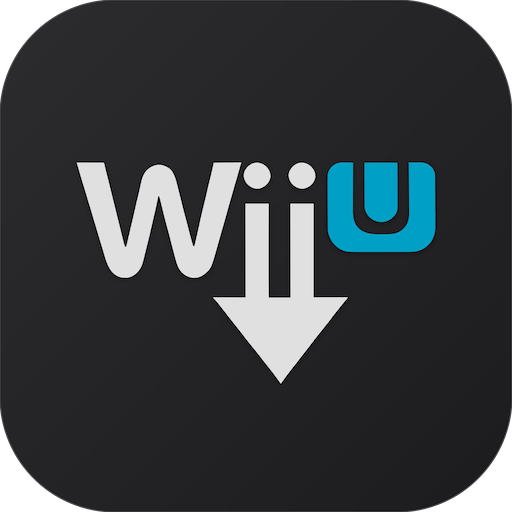
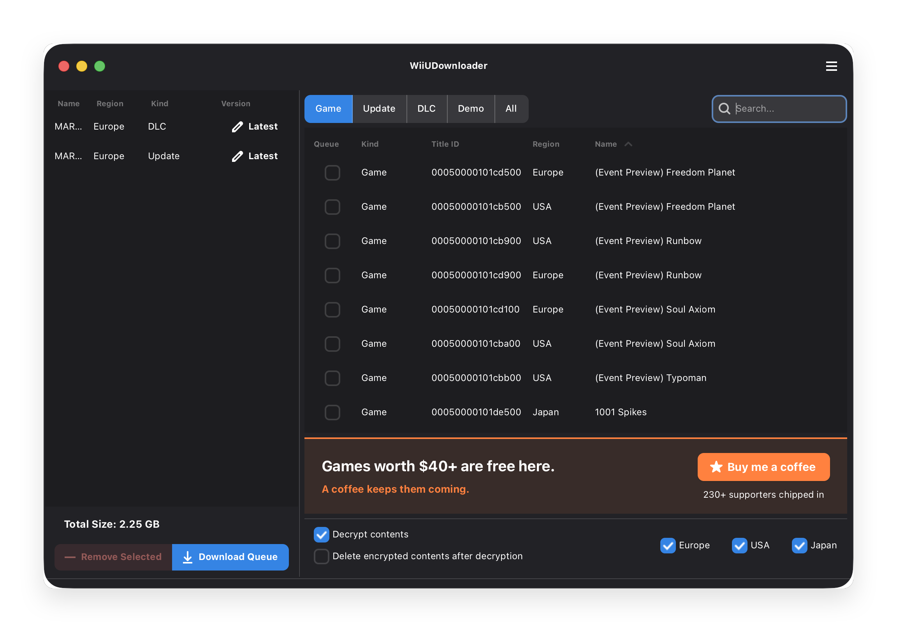
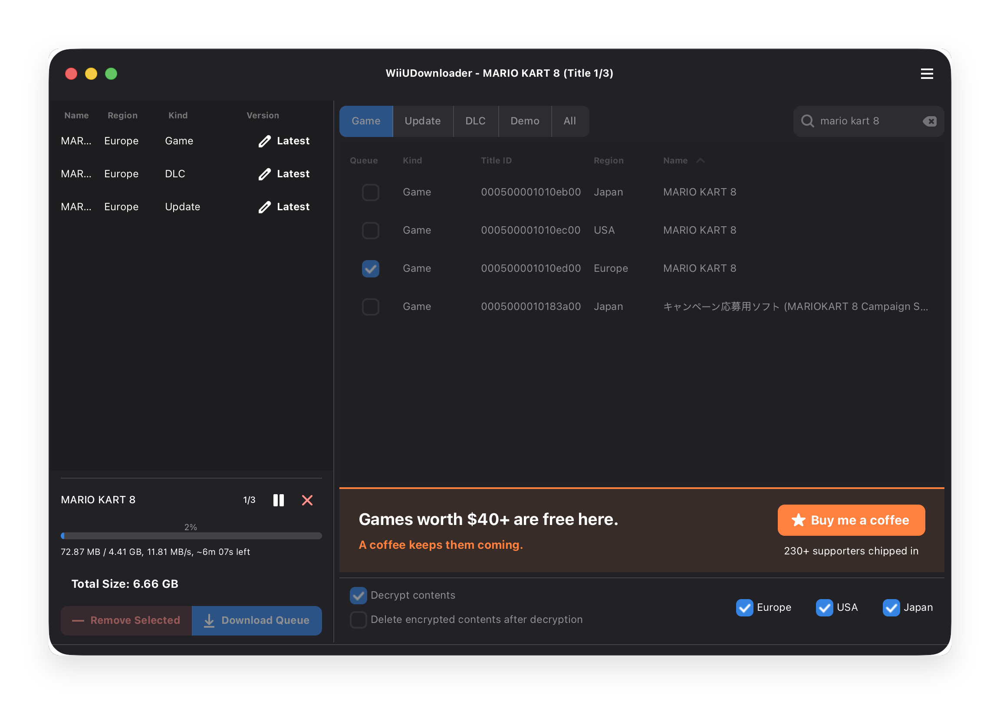

<p align="center">
  
</p>

<h1 align="center">WiiUDownloader</h1>

<p align="center">
  <strong>The open-source Wii U downloader that works on Windows, macOS, and Linux.</strong><br>
  Download Wii U games, updates, DLC, and demos directly from Nintendo's servers, no title keys needed.
</p>

<p align="center">
  <a href="https://github.com/Xpl0itU/WiiUDownloader/releases/latest"></a>
  <a href="https://github.com/Xpl0itU/WiiUDownloader/blob/main/LICENSE"></a>
  
  <a href="https://github.com/Xpl0itU/WiiUDownloader/stargazers"></a>
  <a href="https://ko-fi.com/L3L5JUPXR"></a>
</p>

---

## Screenshots

<p align="center">
  
  
</p>

---

## Looking for a Wii U USB Helper alternative?

Wii U USB Helper is abandoned. It only runs on Windows. Antivirus software frequently flags it. Setup requires hunting down title key sites that come and go, and even when you get it working, server connection failures are constant.

**WiiUDownloader is the replacement the community recommends.** It runs on Windows, macOS, and Linux. It downloads directly from Nintendo's CDN (NUS). No title keys. No launchers. No manual configuration.

| | Wii U USB Helper | WiiUDownloader |
|---|---|---|
| **Maintained** | No (abandoned) | Yes (active) |
| **Windows** | Yes | Yes |
| **macOS** | No | Yes |
| **Linux** | No | Yes |
| **Open source** | No | Yes (GPLv3) |
| **Title keys required** | Yes | No |
| **Antivirus flags** | Common | None |
| **Setup** | Hunt down title keys, configure launchers | Download, open, ready |

---

## Features

- Browse the full Wii U library: games, updates, DLC, demos, and Virtual Console titles
- Search by name or Title ID
- Queue multiple titles for batch download
- Filter by region (Japan, USA, Europe) and content type
- Automatic decryption, ready for your console or Cemu
- Optional: delete encrypted files after decryption to save disk space
- Resume interrupted downloads
- Re-decrypt previously downloaded files without re-downloading
- Command-line interface (`wiiudl`) and full-screen TUI for Linux and macOS, with JSON output for scripting

---

## Installation

Pick your platform. Double-click. Done.

| Platform | Download |
|---|---|
| **Windows** | [WiiUDownloader-Windows.zip](https://github.com/Xpl0itU/WiiUDownloader/releases/latest/download/WiiUDownloader-Windows.zip) |
| **macOS** (Intel + Apple Silicon) | [WiiUDownloader-macOS-Universal.dmg](https://github.com/Xpl0itU/WiiUDownloader/releases/latest/download/WiiUDownloader-macOS-Universal.dmg) |
| **Linux** (Intel/AMD 64-bit) | [WiiUDownloader-Linux-x86_64.AppImage](https://github.com/Xpl0itU/WiiUDownloader/releases/latest/download/WiiUDownloader-Linux-x86_64.AppImage) |
| **Linux** (ARM 64-bit) | [WiiUDownloader-Linux-aarch64.AppImage](https://github.com/Xpl0itU/WiiUDownloader/releases/latest/download/WiiUDownloader-Linux-aarch64.AppImage) |

**Linux users:** make the AppImage executable before running:

```bash
chmod +x WiiUDownloader-Linux-x86_64.AppImage   # Intel/AMD
chmod +x WiiUDownloader-Linux-aarch64.AppImage  # ARM
```

---

## How to download Wii U games

1. Launch WiiUDownloader
2. Search for a title or browse the list
3. Select your regions (Japan, USA, Europe) and content type (Game, Update, DLC, Demo, or All)
4. Click the **queue** checkbox on the titles you want
5. (Optional) Enable **Decrypt contents** if you want playable files for your console or Cemu
6. (Optional) Check **Delete encrypted contents after decryption** to save space
7. Click **Download queue** and pick where to save

Already downloaded files that need decryption? Go to **Tools → Decrypt Contents** and select the folder.

For a detailed walkthrough, see the [WiiUDownloader Usage Guide](https://xpl0itu.github.io/WiiUDownloaderDocs/docs/).

---

## Why WiiUDownloader over other Wii U download tools

**No title keys.** Other tools make you hunt down title keys from third-party sites. Those sites go offline. The files get outdated. WiiUDownloader generates what it needs.

**Cross-platform.** The only actively maintained Wii U NUS downloader that works on Windows, macOS, and Linux. Use it on your desktop, laptop, or Steam Deck.

**Open source.** The full source code is here. Anyone can audit it. No obfuscation, no surprises.

**Actively maintained.** Bugs get fixed. New features ship regularly. The project is alive.

**Simple.** Download, open, get your games. No command-line flags. No tutorials required.

---

## Frequently asked questions

### Is WiiUDownloader safe?

Yes. The source code is public under the GPLv3 license, anyone can audit it. Wii U USB Helper is frequently flagged by antivirus software because it's closed-source and hooks into system processes. WiiUDownloader is transparent.

### Does this work on Mac?

Yes. Universal binary supports both Intel and Apple Silicon Macs. The only Wii U downloader with native macOS support.

### Does this work on Linux?

Yes. AppImage available for x86_64 and aarch64. Works on Steam Deck.

### Does this work on Steam Deck?

Yes. Download the Linux AppImage, make it executable, and run it in Desktop Mode. You can also add it as a non-Steam game to launch from Game Mode.

### Do I need title keys?

No. WiiUDownloader generates decryption keys from the title data itself.

### Can I use downloaded games with Cemu?

Yes. Decrypted files work directly with the Cemu Wii U emulator on PC.

### How do I fix "Wii U USB Helper not working"?

Stop fighting with it. Wii U USB Helper is abandoned, it hasn't been updated in years. Server endpoints change, title key sites disappear, and nobody is fixing the bugs. Switch to WiiUDownloader.

---

## Building from source

```bash
git clone https://github.com/Xpl0itU/WiiUDownloader.git
cd WiiUDownloader
curl --compressed -Lo db.go -H 'User-Agent: NUSspliBuilder/2.2' 'https://napi.v10lator.de/db?t=go' && if grep -q 'var titleEntry =' db.go; then if grep -q 'type TitleEntry struct' db.go; then sed -i '/type TitleEntry struct/,/}/d' db.go; fi && sed -i 's/var titleEntry =/func init() { TitleDatabase =/' db.go && echo '}' >> db.go; fi
cd cmd/WiiUDownloader && go build -o ../../WiiUDownloader .
```

Requires Go 1.26+ and GTK+4 development libraries.

---

## Command-line interface (macOS and Linux)

`wiiudl` is a GTK-free CLI built from the same core library as the desktop app.
It supports searching the title database, inspecting titles, downloading games,
listing and extracting individual files, and decrypting existing downloads.

### Build

No GTK or libadwaita packages are needed:

```bash
git clone https://github.com/Xpl0itU/WiiUDownloader.git
cd WiiUDownloader
go build -trimpath -o wiiudl ./cmd/wiiudl
# or install it into your Go bin directory:
go install ./cmd/wiiudl
```

### Interactive TUI

Run `wiiudl` with no command in a terminal to open the full-screen TUI, or start
it explicitly:

```bash
./wiiudl
# or
./wiiudl tui
```

The TUI is a guided interface:

- **Search titles** by name or title ID; filter by region and content type.
- **Download** with output folder, version, decryption and cleanup options.
- **Watch live progress** with speed, ETA and a progress bar.
- **Inspect metadata** including TMD version, content count, size and contents.
- **Browse and extract files** from a title without downloading the whole game.
- **Decrypt** an existing title folder.
- **Update the title database** without leaving the interface.

Keyboard highlights:

| Key | Action |
|---|---|
| `↑`/`↓` | Move through menus and lists |
| `Tab` / `Shift+Tab` | Move between search, filters and results |
| `←`/`→` | Change the focused region/type filter, or switch buttons |
| `Enter` | Select, confirm, or open actions |
| `d` / `i` / `f` | Download, show info, or browse files for the selected result |
| `/` | Open search, or jump back to the search box |
| `?` | Open help |
| `a` | In the file browser, extract all currently filtered files |
| `PgUp` / `PgDn` | Scroll info, help, and file listings |
| `Esc` | Back, or cancel the active transfer |
| `Ctrl+C` | Cancel/quit; press twice during a transfer to force quit |
| `q` | Quit from the main menu |

The TUI requires an interactive terminal. When input or output is redirected,
`wiiudl` prints the regular help instead. Every non-interactive command below
still works normally.

### Quick start

```bash
# Download and cache the title database (first run does this automatically)
./wiiudl db update

# Browse and inspect
./wiiudl search zelda
./wiiudl search --region usa --type game --limit 20 mario
./wiiudl info --contents 00050000101c9500

# Download a game (decrypted files ready for Cemu or a console)
./wiiudl download --decrypt -o ~/Games 00050000101c9500

# Names work too; ambiguous matches prompt on a terminal
./wiiudl download --decrypt --delete-encrypted -o ~/Games "Breath of the Wild"

# Pin a title version instead of using the latest
./wiiudl download --version 208 -o ~/Games 00050000101c9500

# List or extract individual files
./wiiudl files 00050000101c9500 --filter .rpx
./wiiudl extract 00050000101c9500 --file code/U-King.rpx -o ~/Downloads

# Decrypt a folder downloaded earlier without --decrypt
./wiiudl decrypt --delete-encrypted "$HOME/Games/Game [Game] [00050000101c9500]"
```

### Commands

| Command | What it does |
|---|---|
| `search [query...]` | Search titles by name or title ID; no query lists the database |
| `info <title...>` | Show database metadata, TMD version, content count and size |
| `files <title>` | List the files inside a title (downloads only its FST) |
| `download <title...>` | Download one or more titles, optionally decrypting them |
| `extract <title>` | Download and extract selected files (`--file`, `--filter`, `--all`) |
| `decrypt <dir...>` | Decrypt folders left by a download without `--decrypt` |
| `tui` | Start the full-screen interactive interface |
| `db update\|info\|clear` | Manage the cached title database |
| `version` | Print the CLI version |

Run `./wiiudl help <command>` for the full flag list of any command.

Useful global flags: `--db PATH` (use a local JSON or generated Go database),
`--no-db-fetch`, `--quiet`, and `--json` (search, info, files, download,
extract, decrypt and db update; the TUI always renders its own interface).
A title argument is either a 16-digit hex title ID or a name/query. In scripts,
prefer title IDs or pass `--first` when a name may match multiple regions.

### Title database

On first use `wiiudl` downloads the same database the GUI builds into `db.go`
and caches it:

- Linux: `~/.cache/WiiUDownloader/titles.json` (or `$XDG_CACHE_HOME`)
- macOS: `~/Library/Caches/WiiUDownloader/titles.json`

Refresh it with `wiiudl db update`. Set `WIIUD_DB_URL` to use a mirror, or pass
`--db PATH` to use a custom database file. If the database cannot be fetched and
the command only uses title IDs, `wiiudl` continues using the IDs alone. You can
also generate `db.go` before building (see the GUI instructions above) and the
CLI will use it as a built-in fallback.

### Exit codes and interrupts

- `0`: success
- `1`: one or more operations failed
- `2`: usage error
- `130`: interrupted

In regular commands the first Ctrl+C cancels the current transfer cleanly; press
it again to force quit. Progress is written to stderr, so `--json` output on
stdout stays clean. In the TUI, `Esc` cancels a transfer, `Ctrl+C` quits, and a
second `Ctrl+C` during a transfer force-quits.

---

## Important notes

WiiUDownloader downloads content from Nintendo's servers. Make sure you follow applicable laws in your country. Downloading copyrighted material without authorization may violate copyright law.

## License

GPLv3. See [LICENSE](LICENSE).

---

## Acknowledgments

Built with these excellent open-source libraries:

- [gotk4](https://github.com/diamondburned/gotk4), Go bindings for GTK+4
- [golang.org/x/crypto](https://golang.org/x/crypto), Cryptographic primitives
- [golang.org/x/sync](https://golang.org/x/sync), Concurrency utilities
